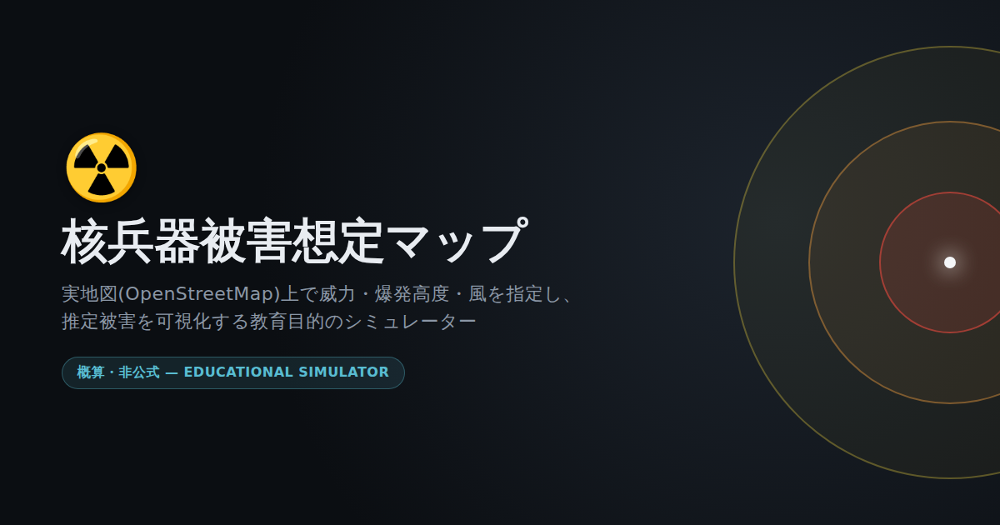
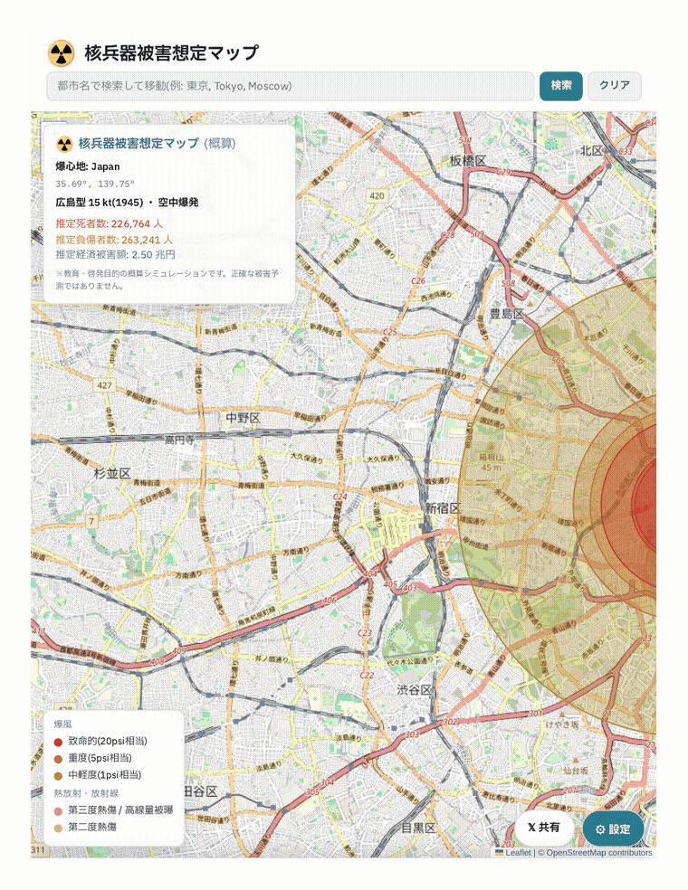

# 核兵器被害想定マップ(実地図版)

投下地点・威力(kt)・爆発高度・風向風速を指定すると、爆風・熱放射・放射性降下物による推定被害(死者数・負傷者数・経済被害額)を実際の地図(OpenStreetMap)上に表示する教育・啓発目的のシミュレーターです。

**▶ ライブデモ: https://lunarmodule7.github.io/nuke-damage-map/**

解説記事: [核兵器被害想定マップ: もし核が自分の街に落ちたら](http://blog.livedoor.jp/lunarmodule7/archives/5729756.html)(ブログ「A Successful Failure」)

## できること

- 地図上の任意の地点をクリックして爆心地を指定
- プリセット(戦術核〜史上最大の水爆まで)または任意のkt値を入力
- 空中爆発・地上爆発の切り替え、地上爆発時は風向・風速を指定して放射性降下物のプルームを表示
- 爆風(致命的・重度・中軽度)、熱放射、放射性降下物の各範囲を地図上に可視化
- 推定死者数・負傷者数・経済被害額を国別統計・主要都市人口データから概算
- 現在の設定をURLに保存して共有可能(X共有ボタンあり)

## 免責事項

本ツールは公開されている簡易な物理スケーリング則(Glasstone & Dolan由来のcube-root則等)と、国別統計・主要都市人口データに基づく粗い近似モデルにより概算値を表示する教育・啓発目的のシミュレーターです。実際の兵器効果、地形・建築物・気象条件・軍事的判断等は一切考慮していません。経済被害額は米ドル換算値を概算レートで円換算しており、実勢レートとは異なります。表示される数値は正確な予測ではなく、意思決定や実際の被害想定の根拠として使用しないでください。

## 算出方法

爆風・熱放射・放射性降下物の計算式や人口・被害モデルの詳細は [METHODOLOGY.md](METHODOLOGY.md) を参照。

## データ・ライセンス

地図データ: © [OpenStreetMap](https://www.openstreetmap.org/copyright) contributors。国境線・国別人口/GDP/面積・世界の都市人口データは [Natural Earth](https://www.naturalearthdata.com/)(パブリックドメイン)。日本国内の市区町村座標は [code4fukui/localgovjp](https://github.com/code4fukui/localgovjp)([CC0](https://creativecommons.org/publicdomain/zero/1.0/))、市区町村別人口は [code4fukui/e-stat](https://github.com/code4fukui/e-stat)([MIT License](https://github.com/code4fukui/e-stat/blob/main/LICENSE))を使用。

このリポジトリ自体のコードは [MIT License](LICENSE) の下で公開しています。
